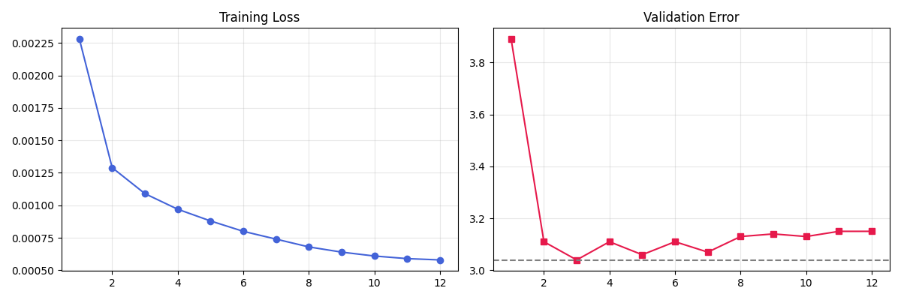
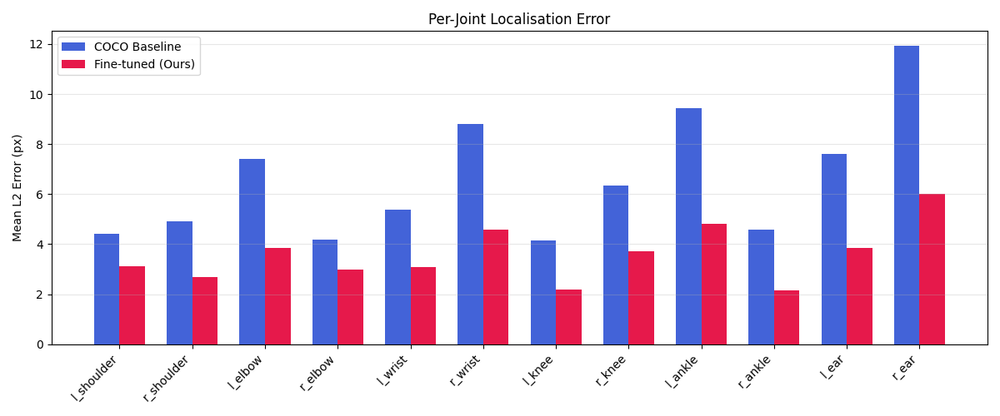
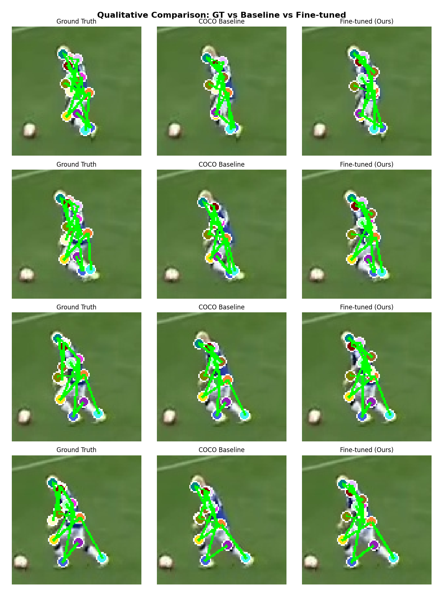
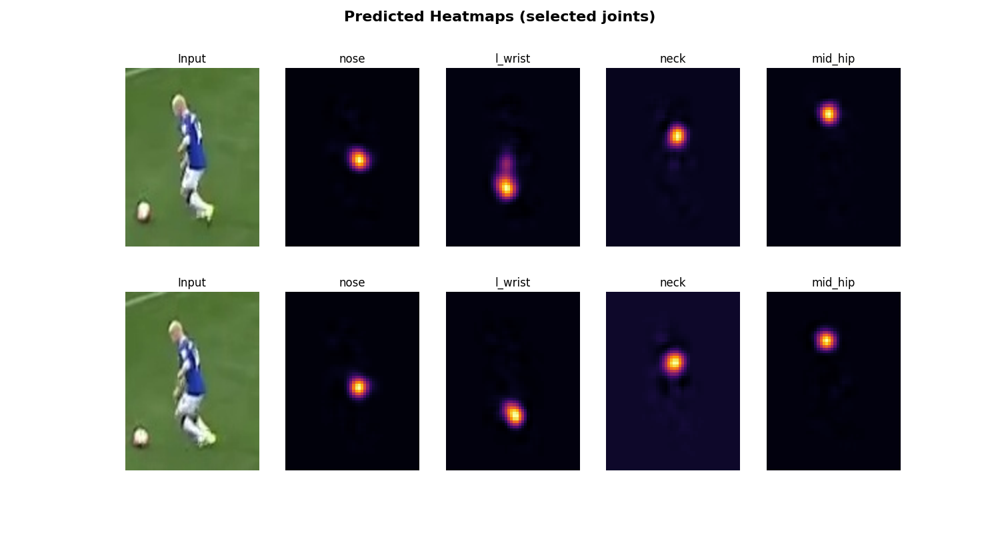

<div align="center">

# 3DSP-ViTPose: Fine-Tuned Vision Transformer for 3D Shot Posture Estimation

[](https://pytorch.org/)
[](https://huggingface.co/docs/transformers)
[](https://huggingface.co/usyd-community/vitpose-base-simple)
[](https://www.nvidia.com/en-us/data-center/tesla-t4/)
[](LICENSE)

**45.6% reduction in mean keypoint error** over the COCO-pretrained baseline by
fine-tuning ViTPose-Base (85.9M params) on a mixed 3DSP + CrowdPose corpus.

</div>

---

## Overview

This project fine-tunes **ViTPose-Base-Simple** on the domain-specific
**3D-Shot-Posture Dataset (3DSP)** -- 200 film shots, 20 frames each --
supplemented with **23,937** filtered in-the-wild samples from **CrowdPose**.
A 3x oversampling strategy balances the scarce domain data against the larger
general corpus. After 12 epochs on a Tesla T4, the model achieves a mean L2
error of **3.59 px** (baseline: 6.59 px) across 400 held-out frames and 12
exactly-matched joints.

---

## Architecture

```
INPUT (192 x 256 x 3, ImageNet-normalised)
        |
   Patch Embedding (16x16) --> 192 tokens
        |
   ViT-Base Encoder (12 layers, 12 heads, d=768)
        |
   Reshape --> (B, 768, 12, 16)
        |
   Simple Decoupled Head (4 conv layers + 1x1 conv)
        |
   17 Heatmaps (48 x 64) --> Soft-Argmax (tau=100) --> 17 Keypoints
```

| Component | Detail |
|-----------|--------|
| Backbone | ViT-Base: 12 blocks, 12 heads, d_model = 768 |
| Input | 192 x 256, ImageNet mean/std |
| Output | 17 heatmaps at 48 x 64 |
| Parameters | 85.9M |
| Decoding | Soft-argmax, tau = 100 |

Before fine-tuning, the 1x1 conv head is re-initialised (N(0, 0.01), zero
bias) to remove COCO-layout bias.

---

## Datasets

| Dataset | Samples | Role |
|---------|---------|------|
| 3DSP (train) | 3,600 frames x 3 oversample = 10,800 | Domain-specific |
| CrowdPose (filtered) | 23,937 | In-the-wild generalisation |
| 3DSP (val) | 400 frames (20 shots) | Held-out evaluation |

CrowdPose 14-keypoint annotations are mapped to the 3DSP 17-keypoint layout.
Three joints (pelvis, spine, shoulder centre) are derived via spatial averaging.
Filtering: iscrowd = 0, >= 8 visible keypoints, bbox >= 40x60 px.

---

## Training

| Hyperparameter | Value |
|---------------|-------|
| Optimiser | AdamW (lr = 1e-5, wd = 1e-4) |
| Schedule | 1-epoch linear warmup + cosine decay to 0.1x |
| Epochs / Batch | 12 / 8 |
| Loss | Visibility-masked MSE on Gaussian heatmaps (sigma = 2.0) |
| Augmentation | Horizontal flip (p = 0.5) with joint-pair swap |
| Gradient clip | 1.0 |
| Hardware | NVIDIA Tesla T4, 15.6 GB |
| Duration | ~4.5 hours |

Best validation error: **3.04 px** at Epoch 3.

---

## Results

**400 validation frames, 12 exact joints (limbs + shoulders):**

| Model | Mean L2 (px) | Median L2 (px) |
|-------|:------------:|:--------------:|
| COCO-pretrained baseline | 6.59 | 3.41 |
| **Fine-tuned (ours)** | **3.59** | **2.05** |
| **Improvement** | **-45.6%** | **-39.9%** |

### Training Curves



### Per-Joint Error



### Qualitative Comparison (GT / Baseline / Fine-tuned)



### Predicted Heatmaps



---

## Repository Structure

```
3DSP-ViTPose/
|-- configs/default.py          All hyperparameters and keypoint definitions
|-- data/
|   |-- download.py             Clone 3DSP + download CrowdPose
|   |-- crowdpose_preprocess.py Filter and remap CrowdPose to 17-kp
|   +-- dataset.py              MixedPoseDataset (PyTorch)
|-- models/vitpose.py           Model factory + checkpoint loading
|-- utils/
|   |-- keypoints.py            COCO-to-3DSP remapping
|   +-- heatmap.py              Gaussian targets + soft-argmax
|-- train.py                    Training loop
|-- evaluate.py                 Baseline vs fine-tuned evaluation
|-- visualize.py                Figure generation
|-- assets/                     Pre-generated plots (see above)
|-- scripts/run_all.sh          End-to-end pipeline
+-- requirements.txt
```

---

## Quick Start

```bash
git clone https://github.com/alasaar/3DSP-ViTPose.git
cd 3DSP-ViTPose
pip install -r requirements.txt

# Download datasets
python -m data.download

# Train (~4.5 h on T4)
python train.py

# Evaluate
python evaluate.py --checkpoint checkpoints/vitpose_B_mix_best.pt

# Generate figures
python visualize.py --checkpoint checkpoints/vitpose_B_mix_best.pt
```

Model weights (~344 MB) are hosted on
[GitHub Releases](https://github.com/alasaar/3DSP-ViTPose/releases/tag/v1.0.0)
due to repository size limits.